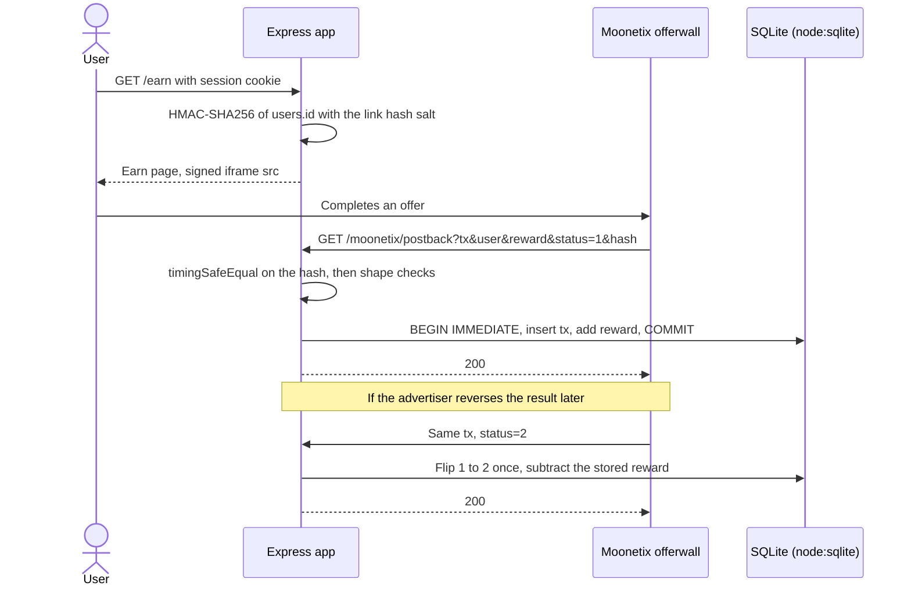

# Moonetix Offerwall for Express

**An Express 5 app on Node.js 22 that signs the offerwall link for the signed-in user and credits each completed offer exactly once.**

[](https://github.com/moonetix/offerwall-express/actions/workflows/ci.yml)
[](LICENSE)
[](https://docs.moonetix.com/postbacks)
[](https://moonetix.com/register)
[](https://moonetix.com/academy/integrations/offerwall-postback-nodejs)
[](https://moonetix.com/integrations/website)
[](package.json)

Express is the only package. Storage is `node:sqlite`, hashing is `node:crypto`, and tests run on `node --test`. The [Moonetix](https://moonetix.com) offerwall appears on an Earn page as an iframe, and the same signed link is available as JSON for a single-page front end. Moonetix is an affiliate network: your users earn your own currency by completing offers, and you earn per completed offer.

> **Get your App ID and keys: sign up free at https://moonetix.com/register**

## What it handles for you

1. **Retries and duplicates.** `transaction_id` is the primary key of the ledger. Ten copies of one credit sent at the same moment pay once, and the test suite sends exactly that.
2. **Reversals.** Status 2 takes back the amount stored with the credit, from the user who got it, once. A reversal that arrives before any credit is recorded, so a late credit for it pays nothing.
3. **Failures.** The answer is 200 only after `COMMIT`. A database error rolls back the whole change and answers 500, and the retry from Moonetix goes through cleanly. That path is tested with a forced failure halfway through a credit.

## Request flow



## Quick start

Node.js 22.13 or later. `node:sqlite` needs no flag from 22.13 on.

```bash
git clone https://github.com/moonetix/offerwall-express.git
cd offerwall-express
npm install
cp .env.example .env              # fill in your Moonetix keys and a SESSION_SECRET
npm run create-user -- demo       # prints a random password
npm start                         # http://127.0.0.1:3000
```

Sign in at `/login`, confirm the age check, and the Earn page shows the offerwall.

| Variable | Where to find it |
| --- | --- |
| `MOONETIX_APP_ID` | Dashboard, Offerwalls, your offerwall, Integration |
| `MOONETIX_LINK_SALT` | Same section: the link hash salt. Signs offerwall links. |
| `MOONETIX_POSTBACK_KEY` | Postback page: the postback secret key. Signs postbacks. |
| `SESSION_SECRET` | Any long random string. Signs the demo session cookie. |
| `PORT` | Optional, default `3000`. |
| `HOST` | Optional, default `127.0.0.1`. Keep it on loopback behind your reverse proxy. |
| `DATABASE_PATH` | Optional, default `./data/app.sqlite`. Also read by `create-user`. |
| `NODE_ENV` | Optional. `production` marks the session cookie `Secure`, so sign-in then needs https. |

The first four are required. If one is missing, `npm start` exits with `Set MOONETIX_APP_ID, ... in .env or the environment.`

Postback URL for the Postback page of your dashboard:

```text
https://yoursite.com/moonetix/postback?tx={transaction_id}&user={user_id}&reward={reward}&status={status}&event={event_id}&payout={payout}&offer={offer_name}&hash={hash}
```

The iframe only loads on https pages of the website you registered for the app, so on `127.0.0.1` it stays blank. Open the signed link in its own tab, or use an https staging host.

## Routes

| Route | Purpose |
| --- | --- |
| `GET /earn` | Earn page for the signed-in user. Age check first, then the signed iframe. `Cache-Control: private, no-store`. |
| `POST /earn/age` | Records that the user confirmed they are 16 or older. |
| `GET /api/offerwall-link` | `{ "url": "..." }` for a React, Vue or mobile front end. 401 signed out, 403 before the age check. |
| `GET /moonetix/postback` | The postback. Registered before sessions and body parsing. 405 for other methods. |
| `GET /login`, `POST /login`, `POST /logout` | Demo sign-in. Replace with your own. |

| File | Contents |
| --- | --- |
| `src/moonetix.js` | Framework-free: `wallUrl`, `readParams`, `validHash`, `handlePostback`, exact amount parsing |
| `src/store.js` | `node:sqlite` schema and the credit and reversal transaction |
| `src/app.js` | Express routes |
| `src/auth.js`, `src/pages.js` | Demo session cookie (scrypt, HMAC) and HTML |
| `scripts/create-user.js` | Creates a demo user |

`src/moonetix.js` has no Express import. It drops into Fastify, Koa, Hono or a serverless function unchanged. On PostgreSQL, keep the same pattern: `INSERT ... ON CONFLICT DO NOTHING` decides the credit, and a conditional `UPDATE ... WHERE status = 1 RETURNING` decides the reversal, both on one client inside `BEGIN`/`COMMIT`.

## Security notes

- The salt and the postback key are read from the environment and never written into a page or a JSON response.
- The postback hash is checked before anything else. Byte lengths are compared first, because `crypto.timingSafeEqual` throws on unequal lengths. A forged short hash gets 403, not a 500.
- Express 5 parses `?tx=a&tx=b` into an array. `readParams` rejects anything that is not exactly one string, so repeated parameters fail the hash check.
- The signed link uses `req.user.id` from the session. A `user_id` in the query string is ignored.
- Balances are integers in millionths of a coin. `0.75 + 1.23456` is exact; no floating point touches money.
- A reversal may take a balance below zero if the user already spent the coins. Say in your terms that rewards can be taken back.
- `payout`, `event` and `offer` are not signed. The offer name is stored for display only.
- Keep the postback path free of login checks, redirects and per-IP rate limits. All postbacks come from Moonetix servers, and Moonetix does not follow redirects.
- Reward users only for completed offers, never for sign-ups, invites, likes, reviews or other engagement. Users must be 16 or older.

## Test it locally

```bash
npm test
```

```text
# tests 27
# pass 27
# fail 0
```

No keys or network needed. `test/fixtures/moonetix-vectors.json` holds links and postbacks made by the Moonetix link and postback code with fake keys (`demoapp0000000000000001`, `test_link_salt_not_secret`, `test_postback_key_not_secret`). The suite starts the app on a random port with an in-memory database and covers: link signing for four user IDs, sub IDs, credit, retry, decimals, reversal, reversal before credit, negative balance, `test_` postbacks, unknown users, ten parallel copies of one credit, tampered values, uppercase, missing and repeated hashes, POST, missing key, a forced database failure, guest redirects, forged cookies, the age check, a `user_id` in the query string, escaping, and cross-site form posts.

A signed postback by hand, with your key in the shell and demo user 1:

```bash
TX=local_1 U=1 R=150 S=1
HASH=$(node -e 'console.log(require("node:crypto").createHmac("sha256", process.env.MOONETIX_POSTBACK_KEY).update(process.argv[1]).digest("hex"))' "$TX:$U:$R:$S")
curl -i "http://127.0.0.1:3000/moonetix/postback?tx=$TX&user=$U&reward=$R&status=$S&hash=$HASH"
```

The first call answers `Credited`, the second `Already processed`. With `S=2` the coins come back off.

[postback-tester](https://github.com/moonetix/postback-tester) runs the full set of edge cases against `npm start`: a credit and its retry, three kinds of reversal, four forged or unsigned postbacks and five parallel copies of one credit, signed the way Moonetix signs them. Its transaction IDs start with `test_`, which this app verifies and logs without crediting, so it checks the signature handling and the answers; `npm test` covers the balances.

```bash
npx github:moonetix/postback-tester --preset moonetix \
  'http://127.0.0.1:3000/moonetix/postback?tx={transaction_id}&user={user_id}&reward={reward}&status={status}&event={event_id}&payout={payout}&offer={offer_name}&hash={hash}' --user 1
```

## Test it with Moonetix

1. Deploy behind https and save the postback URL on the Postback page.
2. In Offerwalls, your offerwall, Integration, open Check a link. Type user ID `1` into Test a link and compare it with `GET /api/offerwall-link` for that user. They must match character for character.
3. Click **Send a test postback** with status 1, then with status 2. Expect 200 and `Test postback: hash OK, nothing credited`. Test transaction IDs start with `test_` and are never credited. The Postback page has the same button.
4. Reports, Postbacks lists every attempt with your server's status code.
5. Check the offerwall from a home or mobile connection. VPNs, proxies, Tor and data center networks get a block page.

## Troubleshooting

| You see | Cause | Fix |
| --- | --- | --- |
| `403 Invalid hash` in Reports, Postbacks | Wrong key, a missing or repeated `hash`, or a value changed on the way. | Use the postback secret key, not the link hash salt. Check the URL has `hash={hash}` once. Paste the logged URL into the [hash checker](https://moonetix.com/tools/postback-hash-checker). |
| `400 Bad parameters` | Signed, but `tx` is empty or over 191 characters, `reward` is not a plain number, or `status` is not 1 or 2. | Map each macro to the parameter name in the postback URL above. |
| `200 Unknown user, nothing credited` | The `user_id` in the link is not a `users.id` in this database. | Sign the link with the same ID your postbacks credit. Here that is the numeric `users.id`. |
| `500 Error` | The database write failed and was rolled back. Moonetix retries. | Check the server log line `moonetix: postback failed` and that `DATABASE_PATH` is writable. |
| Blank iframe on the Earn page | The page is not an https page of the site registered for the app. | Use an https host on that domain, or open the signed link in its own tab. |
| Link not valid page | The link was signed with the wrong salt or for a different user ID. | Compare `GET /api/offerwall-link` with Check a link in the dashboard. |

## Further reading

- Academy: [Offerwall postback in Node.js, Express and Next.js](https://moonetix.com/academy/integrations/offerwall-postback-nodejs)
- Academy: [Postback security](https://moonetix.com/academy/traffic-quality/postback-security) and [Prevent duplicate reward credits](https://moonetix.com/academy/integrations/prevent-duplicate-reward-credits)
- Academy: [Add a floating Earn button to any website](https://moonetix.com/academy/integrations/floating-earn-button)
- Moonetix for web apps: [moonetix.com/industries/web-apps](https://moonetix.com/industries/web-apps) and [website integration](https://moonetix.com/integrations/website)
- Docs: [Offerwall link](https://docs.moonetix.com/offerwall-link), [Postbacks](https://docs.moonetix.com/postbacks), [Credits and reversals](https://docs.moonetix.com/credits-and-reversals), [Testing](https://docs.moonetix.com/testing)
- Tools: [Offerwall link builder](https://moonetix.com/tools/offerwall-link-builder), [Postback hash checker](https://moonetix.com/tools/postback-hash-checker)

## Get your keys

**Sign up free at https://moonetix.com/register**

Publisher applications are reviewed by hand. After approval, add your site as an app, set the currency name and rate, and copy the three keys into `.env`.

## More Moonetix examples

| Repo | What it is |
| --- | --- |
| [awesome-offerwalls](https://github.com/moonetix/awesome-offerwalls) | Curated offerwall resources and guides |
| [offerwall-postback-handlers](https://github.com/moonetix/offerwall-postback-handlers) | Postback handlers in PHP, Node.js, Python and Java |
| [offerwall-nextjs-starter](https://github.com/moonetix/offerwall-nextjs-starter) | Next.js starter with a signed offerwall link |
| [telegram-mini-app-offerwall](https://github.com/moonetix/telegram-mini-app-offerwall) | Telegram Mini App with an offerwall |
| [discord-rewards-bot](https://github.com/moonetix/discord-rewards-bot) | Discord bot that rewards offer completions |
| [moonetix-offerwall-wordpress](https://github.com/moonetix/moonetix-offerwall-wordpress) | WordPress plugin |
| [offerwall-laravel](https://github.com/moonetix/offerwall-laravel) | Laravel Earn page and postback route |
| [offerwall-django](https://github.com/moonetix/offerwall-django) | Django Earn page and postback view |
| [postback-tester](https://github.com/moonetix/postback-tester) | Sends signed test postbacks and catches double credits, missed reversals and forged requests |
| [signup-guard](https://github.com/moonetix/signup-guard) | Sign-up risk checks for Node.js and PHP: disposable emails, datacenter and Tor IPs |
| [datacenter-ip-ranges](https://github.com/moonetix/datacenter-ip-ranges) | Daily cloud, Tor and iCloud Private Relay IP ranges from official feeds |
| [offerwall-fraud-playbook](https://github.com/moonetix/offerwall-fraud-playbook) | Fraud playbook for offerwall and rewards publishers, with tested code |
| [reward-economy-kit](https://github.com/moonetix/reward-economy-kit) | Integer points math: payout to points, bonuses, reversals, cash-out pricing |
| [referral-engine](https://github.com/moonetix/referral-engine) | Referral codes, attribution and a clawback-safe commission ledger |
| [gamification-kit](https://github.com/moonetix/gamification-kit) | Streaks, XP levels, quests and leaderboards that survive time zones and DST |
| [affiliate-postback-macros](https://github.com/moonetix/affiliate-postback-macros) | Postback macros and signatures of tracking platforms and offerwalls |
| [country-tiers](https://github.com/moonetix/country-tiers) | Tier 1, 2 and 3 countries as JSON and CSV, with helpers in JavaScript, PHP and Python |

## License

MIT. See [LICENSE](LICENSE).
